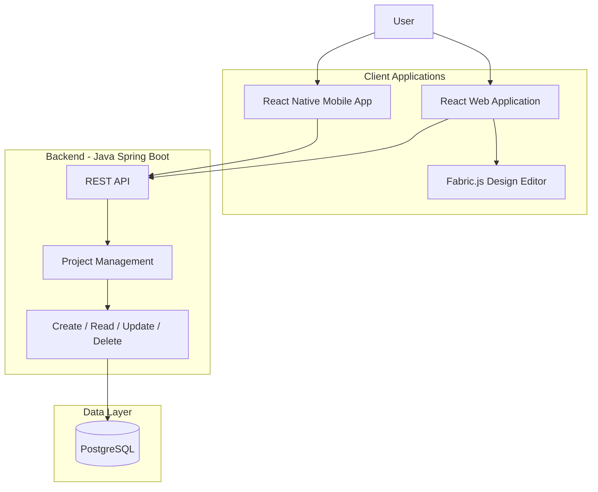
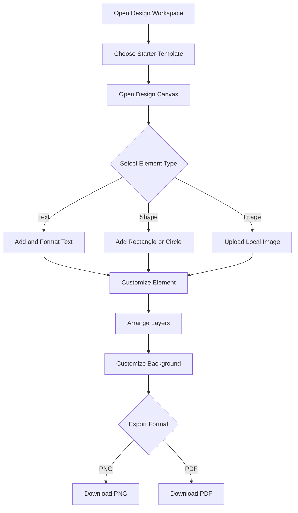

# 🎨 Designly — Canva-Inspired Design Platform

\<p align="center">   \   \   \   \   \ \</p>

\<p align="center">   \<strong>Design Anything. Create Without Limits.\</strong>   \<br/>\<br/>   A full-stack, Canva-inspired graphic design platform with a React web application, React Native mobile application, and Java Spring Boot backend. \</p>

\<p align="center">   \<strong>🎨 Create Designs\</strong> &nbsp; • &nbsp;   \<strong>🖼️ Customize Templates\</strong> &nbsp; • &nbsp;   \<strong>📱 Design on Mobile\</strong> &nbsp; • &nbsp;   \<strong>📤 Export Your Work\</strong> \</p>

---

## 📌 Project Overview

**Designly** is a full-stack graphic design platform designed to provide users with an accessible workspace for creating and customizing digital designs.

Inspired by modern online design tools, the platform brings together a responsive web dashboard, an interactive design editor, a mobile application starter, and a Spring Boot REST API.

The project is structured as a multi-platform application, with separate web, mobile, and backend components.

### 🎯 Project Objectives

- Build a professional online graphic design workspace.
- Provide an interactive canvas for creating designs.
- Allow users to add and customize text, shapes, and images.
- Offer starter templates for faster design creation.
- Save and manage design projects through a backend API.
- Establish a foundation for web and mobile design experiences.
- Create an extensible architecture for future SaaS capabilities.

## ✨ Key Features

### 🖥️ Web Application

- Responsive dashboard and design workspace.
- Project cards and starter templates.
- Interactive design canvas.
- Add and customize text elements.
- Insert rectangles and circles.
- Select and move canvas objects.
- Save projects through the backend API.

### 🎨 Full Design Editor

The editor has been extended using **Fabric.js** to provide a more interactive design experience.

| Feature             | Functionality                                  |
| ------------------- | ---------------------------------------------- |
| Canvas              | 1080 × 1080 design workspace                   |
| Object Manipulation | Drag, move, select, and position objects       |
| Text Editing        | Inline text editing                            |
| Typography          | Font family, size, bold, italic, and alignment |
| Text Color          | Customize text color                           |
| Shapes              | Add rectangles and circles                     |
| Shape Styling       | Fill and opacity controls                      |
| Image Upload        | Upload local images and place them on canvas   |
| Templates           | Choose from preset design templates            |
| Layers              | Select and manage canvas layers                |
| Duplicate           | Duplicate selected objects                     |
| Delete              | Remove selected objects                        |
| Background          | Customize canvas background                    |
| PNG Export          | Export designs as PNG                          |
| PDF Export          | Export designs as PDF                          |

### 📱 Mobile Application

The React Native application provides a starting point for the mobile version of Designly.

- Expo-based application setup.
- React Native navigation starter.
- Foundation for mobile design workflows.
- Extensible structure for future mobile editor functionality.

*The mobile application is currently a starter, not a complete mobile equivalent of the web editor.*

### ⚙️ Backend API

The Java Spring Boot backend provides:

- REST API architecture.
- Project CRUD endpoints.
- PostgreSQL configuration.
- Backend foundation for design-project management.
- Integration point for the React web application.

---

## 🏗️ System Architecture

Designly follows a modular full-stack architecture with three primary applications.



### Architecture Components

| Component          | Technology                             | Responsibility                             |
| ------------------ | -------------------------------------- | ------------------------------------------ |
| Web Application    | React + Vite                           | Dashboard and design workspace             |
| Design Editor      | Fabric.js                              | Interactive canvas and object manipulation |
| Mobile Application | React Native + Expo                    | Mobile application starter                 |
| Backend            | Java + Spring Boot                     | REST API and project operations            |
| Database           | PostgreSQL                             | Persistent project storage                 |
| Export             | Fabric.js and browser export libraries | PNG and PDF output                         |

## 📂 Project Structure

The repository is organized into three independent application directories.

```text
Designly/
│
├── web/
│   ├── src/
│   │   ├── components/
│   │   ├── pages/
│   │   ├── editor/
│   │   └── assets/
│   │
│   ├── package.json
│   └── vite.config.js
│
├── mobile/
│   ├── app/
│   ├── components/
│   ├── package.json
│   └── app.json
│
├── backend/
│   ├── src/
│   │   ├── main/
│   │   └── test/
│   │
│   ├── pom.xml
│   └── src/main/resources/
│
└── README.md
```

*Illustrative structure: actual filenames and subdirectories may differ in the repository.*

---

## 🛠️ Technology Stack

| Category           | Technology   |
| ------------------ | ------------ |
| Frontend           | React        |
| Build Tool         | Vite         |
| Canvas Editor      | Fabric.js    |
| Mobile Framework   | React Native |
| Mobile Development | Expo         |
| Backend Language   | Java         |
| Backend Framework  | Spring Boot  |
| API Architecture   | REST         |
| Database           | PostgreSQL   |
| Build Tool         | Maven        |
| Package Management | npm          |

## 💻 System Requirements

| Requirement | Version / Tool                     |
| ----------- | ---------------------------------- |
| Java        | 17 or newer                        |
| Maven       | Compatible Maven installation      |
| Node.js     | 20 or newer                        |
| npm         | Installed with Node.js             |
| PostgreSQL  | Compatible PostgreSQL installation |
| Expo        | Latest compatible Expo CLI         |

---

## 🚀 Installation & Local Setup

Clone the repository:

```bash
git clone YOUR_GITHUB_REPOSITORY_URL
cd Designly
```

Replace `YOUR_GITHUB_REPOSITORY_URL` with your actual repository URL.

### 1. Backend Setup

Navigate to the backend directory:

```bash
cd backend
```

Configure your PostgreSQL connection using the application's database configuration.

Make sure PostgreSQL is running and the configured database exists.

Start the Spring Boot application:

```bash
mvn spring-boot:run
```

The backend should be available at:

```text
http://localhost:8080
```

Project API:

```text
http://localhost:8080/api/projects
```

### 2. Web Application Setup

Open a new terminal:

```bash
cd web
```

Install dependencies:

```bash
npm install
```

Start the Vite development server:

```bash
npm run dev
```

Open the application:

```text
http://localhost:5173
```

### 3. Mobile Application Setup

Open another terminal:

```bash
cd mobile
```

Install dependencies:

```bash
npm install
```

Start Expo:

```bash
npx expo start
```

Use the Expo development tools to launch the application on a compatible emulator or mobile device.

---

## 🎨 Design Editor Workflow

The web editor provides a foundation for creating and exporting graphic designs.



### Supported Export Formats

| Format | Purpose                             |
| ------ | ----------------------------------- |
| PNG    | Export a raster image of the design |
| PDF    | Export the design as a PDF document |

**Note:** Uploaded images are currently handled locally in the browser session. Cloud-based asset storage and cross-device persistence require further backend integration.

## 🔌 API Integration

The backend exposes project CRUD functionality through the REST API.

| Method                 | Endpoint               | Purpose                                       |
| ---------------------- | ---------------------- | --------------------------------------------- |
| GET                    | `/api/projects`        | Project API entry point                       |
| Additional CRUD routes | Backend implementation | Create, retrieve, update, and delete projects |

The exact request and response schemas, authentication requirements, and additional route definitions should be documented from the backend source code.

## 🔐 Production Readiness

The current implementation is an MVP foundation. Before launching as a public SaaS platform, the following capabilities should be developed and tested.

| Area              | Recommended Enhancement                             |
| ----------------- | --------------------------------------------------- |
| Authentication    | JWT or OAuth2                                       |
| Authorization     | Role-based access control                           |
| Project Storage   | Persistent design-document schema                   |
| Image Uploads     | Cloud object storage                                |
| Export Processing | Reliable server-side export pipeline where required |
| Collaboration     | WebSockets and real-time synchronization            |
| Payments          | Subscription and payment integration                |
| Security          | Input validation, rate limiting, and moderation     |
| Monitoring        | Logging, metrics, and observability                 |
| Reliability       | Automated backups and recovery                      |
| Quality           | Unit, integration, and end-to-end tests             |

## 🔮 Future Enhancements

Potential future development directions:

- [ ] User registration and login.
- [ ] Personal design libraries.
- [ ] Cloud-based image and asset uploads.
- [ ] Persistent project autosave.
- [ ] More professional template categories.
- [ ] Custom fonts and font uploads.
- [ ] Advanced layer ordering and grouping.
- [ ] Undo and redo history.
- [ ] Keyboard shortcuts.
- [ ] Multiple canvas dimensions.
- [ ] Background image and gradient support.
- [ ] Real-time multi-user collaboration.
- [ ] Comments and design sharing.
- [ ] AI-powered design suggestions.
- [ ] AI image generation integration.
- [ ] Subscription and premium templates.
- [ ] Full-featured mobile design editor.
- [ ] Cross-device project synchronization.

*These items are proposed enhancements and should not be considered implemented features unless added to the application.*

## ⚠️ Current MVP Limitations

- The web editor is an MVP, not a complete Canva-equivalent editor.
- The mobile application is currently a navigation starter.
- Browser image uploads are local to the current session.
- Persistent cloud asset storage is not yet integrated.
- Multi-user real-time collaboration is not yet implemented.
- Authentication and role-based access require further development.
- Production payment processing is not included.
- Backend persistence and project-document integration should be verified against the actual implementation.

## 🎓 Learning Outcomes

Designly provides practical experience with:

- Full-stack application architecture.
- React component-based development.
- Vite-based frontend development.
- Interactive canvas manipulation with Fabric.js.
- React Native and Expo application development.
- Java and Spring Boot REST API development.
- PostgreSQL integration.
- CRUD application design.
- PNG and PDF export workflows.
- Multi-platform application planning.
- SaaS architecture and production-readiness considerations.

---

## 👨‍💻 Developer

**Developed by Lakshya Kansal**

Full-Stack Developer | MCA Student | Software Development Enthusiast

Interested in building modern web applications, interactive design tools, scalable backend systems, and AI-powered software solutions.

\<p align="center">
&#x20; \<strong>🎨 DESIGN. CREATE. INSPIRE.\</strong>
&#x20; \<br/>\<br/>
&#x20; \<sub>Designly — Your Creative Workspace, One Platform.\</sub>
\</p>

---

<p align="center">
  <strong>If you find this project interesting, consider giving it a ⭐ on GitHub!</strong>
</p>
